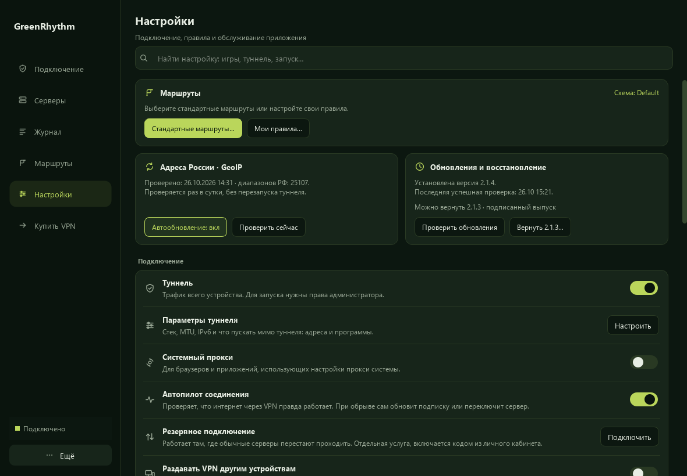
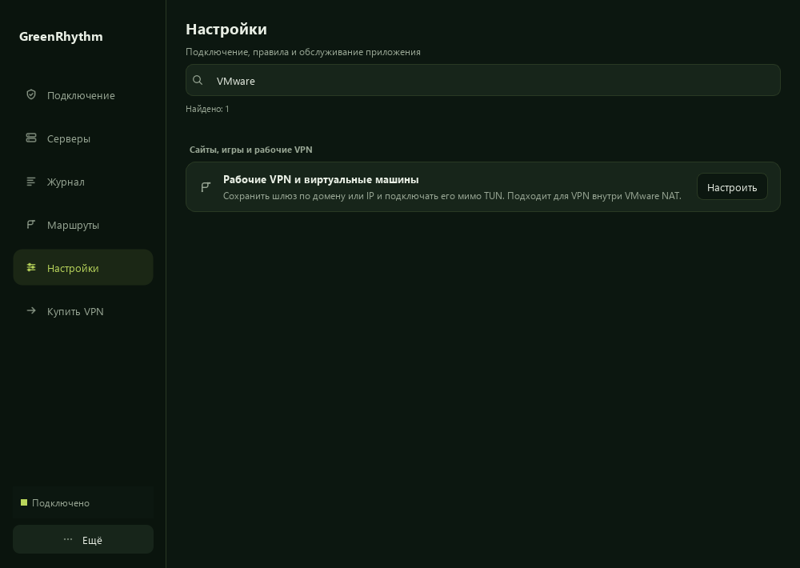
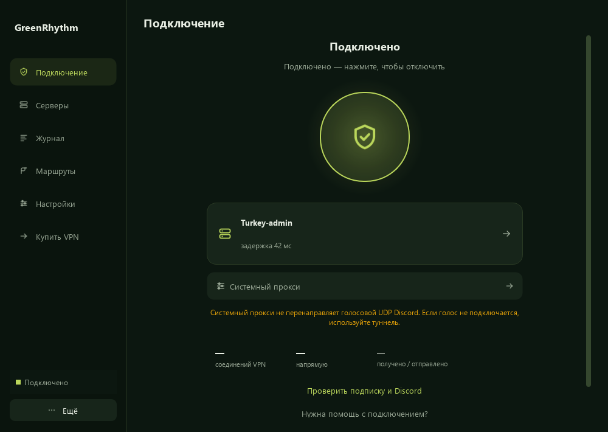

# Настройки

Поиск остаётся вверху при прокрутке страницы. Он ищет по названиям и описаниям,
без учёта регистра и различия «е/ё». Например, `VMware` находит рабочие VPN,
а `Dota` — игры и программы. Очистка возвращает полный список с прежними
значениями. Ввод и Enter ничего не применяют.
Ctrl+F на этой странице фокусирует поиск настроек. Escape очищает непустой
запрос; Enter и NumEnter остаются внутри поиска и не запускают профиль.

Маршруты, база адресов РФ и обновления находятся в начале страницы. На широком
окне две служебные карточки стоят рядом; на узком — друг под другом. Кнопки
переносятся внутри карточки, если им не хватает места. Остальные параметры
собраны в группы. Подтверждения изменения маршрутов и отката версии сохранены.





## Проверка интерфейса без подключения

Отдельный предпросмотр создаёт настоящие виджеты с демонстрационными значениями.
Он не создаёт MainWindow, не читает настройки пользователя и не запускает ядро.

```sh
cmake -S test/settings -B build-settings -DCMAKE_PREFIX_PATH=/path/to/Qt -DCMAKE_BUILD_TYPE=Release
cmake --build build-settings
ctest --test-dir build-settings --output-on-failure
```

Из корня репозитория запустите `settings_preview output.png 1180 820`.
Дополнительный аргумент задаёт поисковый запрос; следующий аргумент `end`
прокручивает страницу вниз. Для работы без окна задайте `QT_QPA_PLATFORM=offscreen`.
В Windows предпросмотр и тесты регистрируют установленные Segoe UI и затем
применяют ту же политику шрифта, что основное приложение.

## Подключение и наблюдение за игрой

Экран подключения оставляет заголовок сверху, а действия прокручиваются при
небольшой высоте окна. Карточка профиля занимает доступную ширину до 520 точек.
Под режимом подключения видно, охватывает ли он голосовой UDP Discord.
Эта подсказка не переключает режим и не меняет правила.

Для предпросмотра подключения задайте аргумент `connection`, для системного
прокси — `proxy`: `settings_preview output.png 1000 710 proxy`.
В «Игры и программы» появилась отдельная кнопка проверки текущих соединений.
Она открывает наблюдение за выбранным процессом без сохранения черновика;
редактор работает отдельным окном и не блокирует окно результатов.


